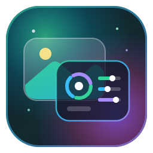
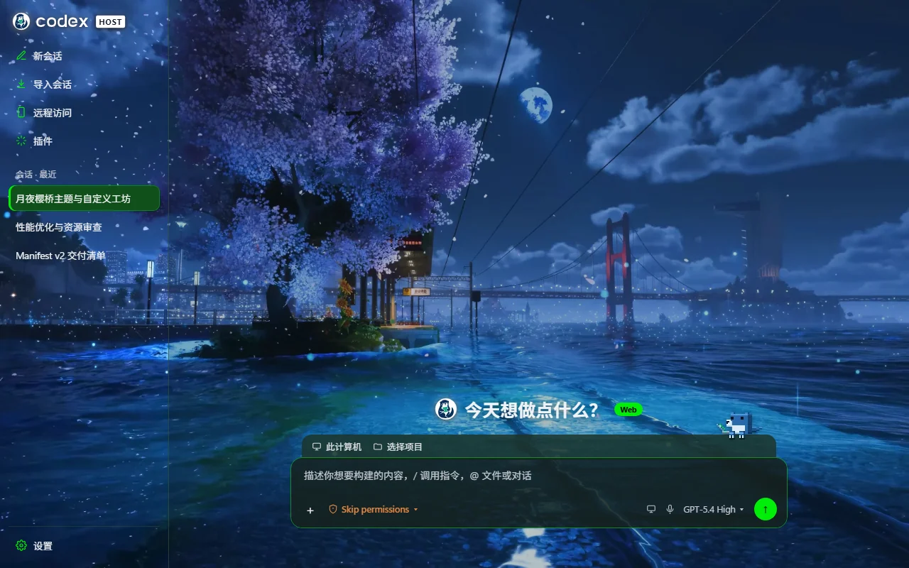
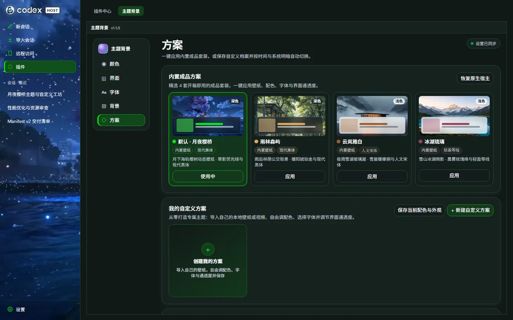
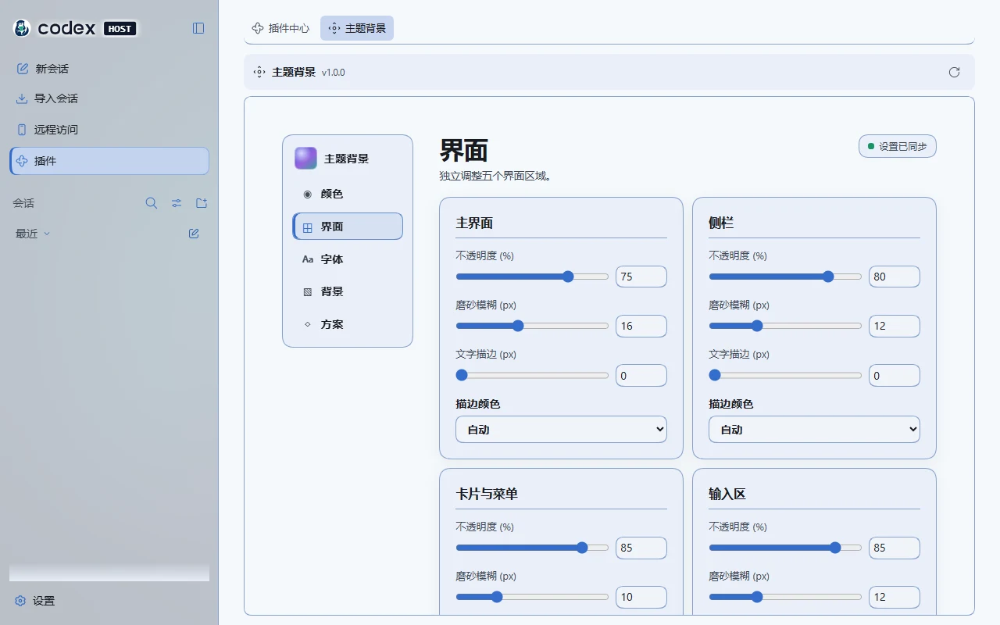

<div align="center">
  
  <h1>Theme Background for CodexHost</h1>
  <p>Unified accent palettes, frosted surfaces, local UI fonts, and rich static/dynamic wallpapers for <strong>Codex Desktop</strong> &amp; <strong>CH Web</strong>.</p>
  <p><strong>English</strong> · <a href="README.zh.md">简体中文</a></p>
</div>

---

## Preview

| Dark Aurora & Emerald Accent | Management Studio (Colors) | Light Glass & Surface Controls |
| :---: | :---: | :---: |
|  |  |  |

---

## Highlights

- **Unified Accent Palette**: Pick any color via HSV color wheel, HEX / RGB / HSL inputs, one-click wallpaper color extraction, or keyboard-accessible pixel eyedropper. Harmonizes buttons, sidebar navigation, tabs, borders, surface tints, text selection, scrollbars, and embedded Host settings while preserving WCAG AA contrast and a luminous top-left CodexHost brand mark.
- **Five Independent Frosted Surfaces**: Independently tune opacity (`0–100%`), frost blur (`0–40 px`), and text outlines for **Main Canvas**, **Sidebar** (with subtle expanded parent-child thread cards), **Cards & Menus**, **Composer**, and **Settings Panel**.
- **Local UI Typography**: Bind a single `WOFF2` / `WOFF` / `TTF` / `OTF` font (up to 50 MiB) to interface text while keeping monospace code blocks, terminals, and icons intact.
- **Static & Animated Backdrops**: Supports public HTTPS images, local `JPEG` / `PNG` / `WebP` / `GIF` / `AVIF` (up to 20 MiB), silent looping `MP4` / `WebM` videos (up to 200 MiB), 30-image rotation pools, Mesh gradients, 4 WebGL shaders (Aurora, Nebula, Flow, Starfield), and 6 Canvas patterns — with independent image/video framing and native wallpaper preview priority in CH Web.
- **Profiles & Day/Night Automation**: Six WCAG-calibrated built-in looks, up to 20 full snapshots (colors, five surfaces, backdrop source, framing, and font), local-time or OS-scheme schedules, and file/text JSON import & export.
- **Pure Frontend Manifest v2**: Zero background processes, zero external telemetry, and full hot enable/disable cleanup.

---

## Installation

### From CodexHost Plugin Center (Recommended)

1. Open **Settings → Plugins** in **Codex Desktop**, or **Plugins → Plugin Center** in **CH Web**.
2. Search for **Theme Background** (`theme-background`), click **Install**, and enable it.
3. Open the **Theme Background** tab to customize your workspace.

### From GitHub Release ZIP

1. Download `theme-background-1.0.1.zip` from [GitHub Releases](https://github.com/TimYuhong/codexhost-theme-background/releases/latest).
2. In CodexHost, choose **Import Plugin → Local .zip** and select the downloaded archive.
3. Enable **Theme Background** — your appearance stays active even after closing the settings page.

---

## Storage & Cross-Device Sync Model

| Data | Where It Lives | Cross-Device Behavior |
| --- | --- | --- |
| Colors, surface opacity/blur/outlines, schedules, profile snapshots, HTTPS URLs, media UUIDs | CodexHost Host extension storage | Synced automatically across Desktop & CH Web |
| Local images, videos, fonts, rotation cursor | Local browser / WebView2 / Electron `IndexedDB` | Private to each profile/partition; use **Link file on this device** to bind a local copy while preserving the shared UUID |

---

## Development & Packaging

Requires **Node.js 24 LTS**, **pnpm 10.32.1**, and **Python 3**.

```sh
pnpm install --frozen-lockfile
pnpm run typecheck
pnpm test
pnpm run build
pnpm run verify
python scripts/pack.py
```

When validating against the official CodexHost `v0.26.0` Zod schema (`packages/shared-contracts`), set `CH_REFERENCE_DIR` and run `pnpm run package`.

- Architecture & protocol: [docs/TECHNICAL_SPEC.md](docs/TECHNICAL_SPEC.md)
- Local setup & isolated testing: [docs/DEVELOPMENT.md](docs/DEVELOPMENT.md)
- Verification & release checklist: [docs/DELIVERY.md](docs/DELIVERY.md)

---

## License

Released under the [MIT License](LICENSE).
