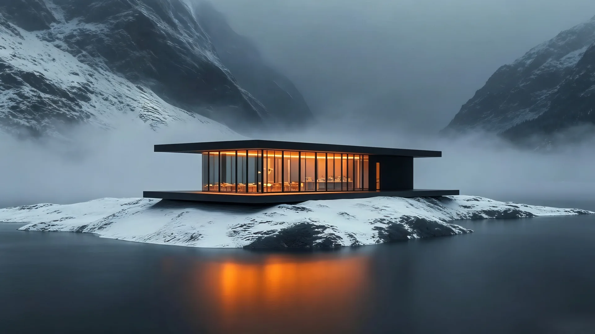

<div align="center">
  
  <h1>Theme Background for CodexHost</h1>
  <p>A pure-frontend visual customization extension for <strong>Codex Desktop</strong> &amp; <strong>CH Web</strong> — curated offline themes, an independent custom theme studio, unified accent palettes, translucent surfaces, UI typography, and an interactive otter composer pet.</p>
  <p><strong>English</strong> · <a href="README.zh.md">简体中文</a></p>
</div>

---

## Preview

| Dark Workspace (Moonlit Sakurabridge) | Theme Studio (`v1.1.3`) | Light Glass Workspace (Glacial Glass) |
| :---: | :---: | :---: |
|  |  |  |

---

## Built-in Theme Suites

Four ready-to-use static HD bundles ship offline with crisp wallpapers (zero frame drops), hue-separated WCAG AA accents, CJK/Latin typography presets, low-opacity canvas & sidebar, and crisp zero-blur cards and composer. Enabling the extension keeps the native Host look untouched — pick any suite below at your own pace, craft your own in the Custom Theme Studio, or restore the native Host look anytime with one click:

| Default · Moonlit Sakurabridge | Rainy Forest | Nordic Minimal | Glacial Glass |
| :---: | :---: | :---: | :---: |
|  |  |  |  |
| Dark · `#00ef07` · Modern Sans | Dark · `#e5a952` · Modern Sans | Light · `#a85d26` · Editorial Serif | Light · `#9e4260` · Airy Clean |

---

## Features

### Built-in Suites & Independent Custom Theme Studio
- **One-Click Built-in Suites**: Instantly switch between 4 curated offline themes or restore the native Host look anytime.
- **Create Custom Themes from Scratch**: Build, edit, duplicate, and save up to 20 independent themes — or click **Save current look** to snapshot your active configuration.
- **Direct Media Import**: Drag-and-drop or import local `JPEG` / `PNG` / `WebP` / `GIF` / `AVIF` images (up to 20 MiB), silent looping `MP4` / `WebM` videos (up to 200 MiB, with automatic poster thumbnails on saved cards), public `HTTPS` image URLs, 30-image rotation pools, Mesh gradients, 4 WebGL shaders, or 6 Canvas patterns.
- **Full Color Studio**: Interactive 2D HSV color wheel, native color well, HEX / RGB / HSL inputs, pixel eyedropper, one-click **Extract from wallpaper**, and **Use current color**.

### Harmonized Workspace & Surfaces
- **Five Independent Surfaces**: Tune opacity (`0–100%`), frost blur (`0–40 px`), and text outlines separately for **Main Canvas**, **Sidebar**, **Cards & Menus**, **Composer**, and **Settings Panel**.
- **Cohesive Reading & Layout Polish**: Reasoning/thinking blocks, command cards, code blocks, and diffs share unified translucent cards; the new-chat composer rests cleanly in the lower area to showcase your wallpaper; Windows custom titlebar buttons (`— / ❐ / ×`) and the top-left CodexHost logo stay crisp across light and dark themes.
- **Built-in Typography & Local Fonts**: Pick from 6 curated CJK/Latin UI font presets (**Modern Sans**, **Airy Clean**, **Editorial Serif**, **Literary Kai**, **Fine FangSong**, **Geometric Tech**) or load a local `WOFF2` / `WOFF` / `TTF` / `OTF` font (up to 50 MiB) while keeping code blocks, terminals, and icons untouched.

### Interactive Otter Pet & Automation
- **Pixel-Voxel Otter & Laptop Companion**: A crisp 2.5D voxel CodexHost otter sits right on the top-right edge of the chat composer beside its tiny glowing emerald-screen laptop — gently bobbing, blinking, flicking its ear, wagging its tail, tapping along on the keyboard as you type, and hopping with a sparkle when clicked (GPU-composited CSS animations that automatically pause on hidden tabs and respect `prefers-reduced-motion`).
- **Day/Night Scheduling & JSON Transfer**: Automatically switch between saved custom themes by local time or OS appearance, and import/export configurations via JSON file or text.
- **Lightweight & Pure Frontend**: Manifest v2 with zero background processes, zero telemetry, O(1) DOM observation during streaming, and complete cleanup on disable or uninstall.

---

## Installation

### CodexHost Plugin Center (Recommended)
1. Open **Settings → Plugins** in **Codex Desktop**, or **Plugins → Plugin Center** in **CH Web**.
2. Search for **Theme Background** (`theme-background`), click **Install**, and enable it.
3. Open the **Theme Background** tab to pick a built-in suite or create your own custom theme.

### Local `.zip` Import
1. Download `theme-background-1.1.3.zip` from [GitHub Releases](https://github.com/TimYuhong/codexhost-theme-background/releases/latest).
2. In CodexHost, choose **Import Plugin → Local .zip** and select the downloaded archive.
3. Enable **Theme Background** — your theme stays active even after closing the settings page.

---

## Storage, Migration & Privacy

| Data | Storage Location | Sync & Migration Behavior |
| --- | --- | --- |
| Colors, surface settings, built-in/custom themes, schedules, HTTPS URLs, media UUIDs | Active Host extension storage (separate directories for Desktop vs. CH Web) | Browsers/tabs connected to the same CH Web server sync automatically; **Codex Desktop and CH Web keep separate Host storage** — mirror your setup anytime via **Profiles → Configuration Import/Export (JSON)** |
| Local images, videos, fonts, rotation state | Local browser / WebView2 / Electron `IndexedDB` | Stored strictly on-device with no upload; after importing JSON on another client, use **Link file on this device** to bind a local copy to the same UUID |

---

## Build from Source

Requires **Node.js 24 LTS**, **pnpm 10.32.1**, and **Python 3**:

```sh
pnpm install --frozen-lockfile
pnpm run typecheck
pnpm test
pnpm run build
pnpm run verify
python scripts/pack.py
```

---

## License

Released under the [MIT License](LICENSE).
