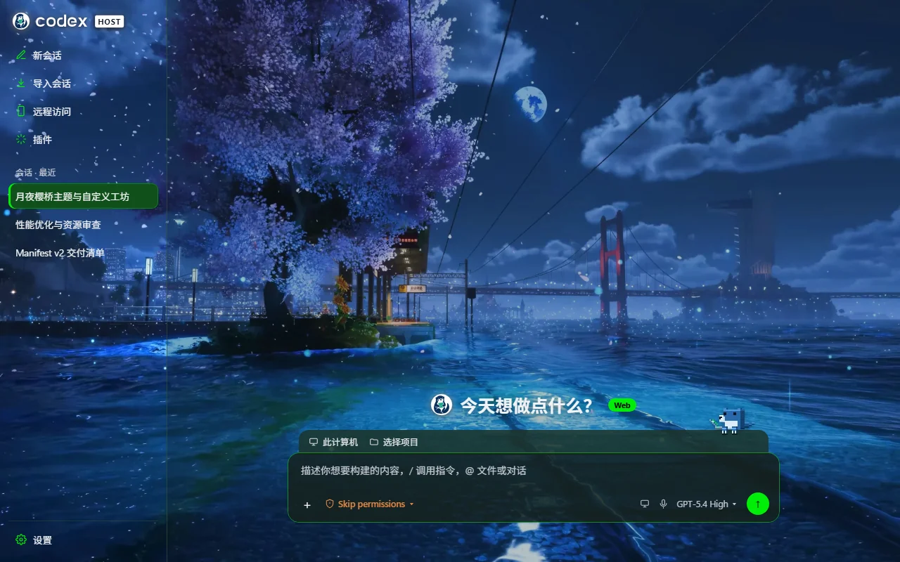
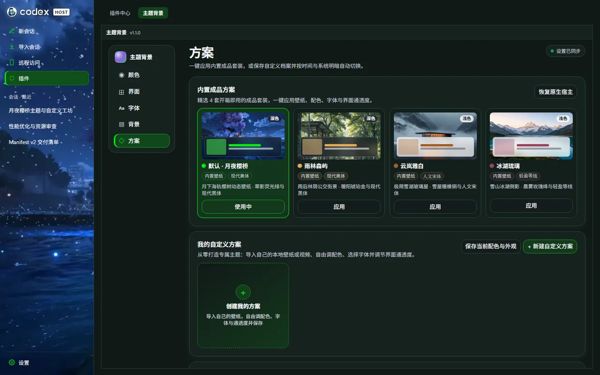
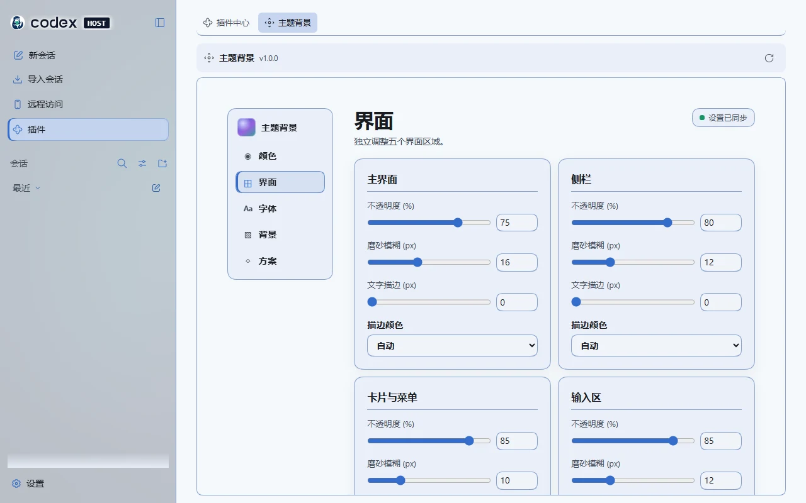

<div align="center">
  
  <h1>Theme Background · 主题背景</h1>
  <p>面向 <strong>Codex Desktop</strong> 与 <strong>CH Web</strong> 的纯前端外观定制扩展：全局主题强调色、五大磨砂界面、本端字体与多源动态壁纸。</p>
  <p><a href="README.md">English</a> · <strong>简体中文</strong></p>
</div>

---

## 效果预览

| 深色极光 + 主题强调色 | 主题背景管理页（颜色） | 浅色毛玻璃 + 五区独立调节 |
| :---: | :---: | :---: |
|  |  |  |

---

## 核心特性

- **全局主题强调色**：提供 HSV 色轮、HEX / RGB / HSL 输入、壁纸一键提色与键盘可用的像素吸管。选中强调色后，按钮、左侧功能栏、工作区文件夹、标签页、边框、表面底色、文本选区、滚动条及宿主内嵌设置弹窗深浅配色同步谐和统一；同时守住 WCAG AA 对比度，并让左上角 CodexHost 品牌标志始终清晰醒亮。
- **五大界面区域独立调节**：可分别微调**主界面**、**侧栏**（含展开父子对话轻分组卡片）、**卡片与菜单**、**输入区**和**设置面板**的不透明度（`0–100%`）、磨砂模糊（`0–40 px`）与文字描边。
- **本端界面字体**：支持单字体 `WOFF2` / `WOFF` / `TTF` / `OTF`（上限 50 MiB）替换界面文字，自动识别 TTC/OTC 字体集并给出提示；代码块、终端与图标字体保持原样。
- **静/动态多源背景**：支持公开 HTTPS 图片、本地 `JPEG` / `PNG` / `WebP` / `GIF` / `AVIF`（上限 20 MiB）、静音循环 `MP4` / `WebM` 视频（上限 200 MiB）、最多 30 张图片的轮换池、网格渐变、4 种 WebGL 着色器（极光、星云、流体、星海）与 6 种几何图案；图片与视频各自保存构图，CH Web 预览内置壁纸时扩展层自动让位。
- **预设、快照与昼夜切换**：内置 6 套经黑白/分区壁纸对比度校准的外观预设，支持保存最多 20 套完整档案（含背景来源、构图与字体），可按本地时间或系统明暗自动切换，并支持 JSON 文件与文本导入导出。
- **纯前端 Manifest v2 架构**：零后台进程、零外部遥测，热禁用或卸载时彻底清理所有样式、图层与监听。

---

## 安装方式

### 从 CodexHost 插件中心安装（推荐）

1. 在 **Codex Desktop** 打开「设置 → 插件」，或在 **CH Web** 打开「插件 → 插件中心」。
2. 搜索 **主题背景**（`theme-background`），点击安装并启用。
3. 打开「主题背景」管理页即可自由配置，关闭管理页后样式仍持续生效。

### 从 GitHub Release 导入 ZIP

1. 前往 [GitHub Releases](https://github.com/TimYuhong/codexhost-theme-background/releases/latest) 下载 `theme-background-1.0.1.zip`。
2. 在插件中心选择「导入插件 → 本地 .zip」并导入压缩包。
3. 启用扩展即可使用。

---

## 数据同步与隐私边界

| 数据类型 | 存储位置 | 跨端表现 |
| --- | --- | --- |
| 主题色、五区参数、昼夜定时、档案快照、HTTPS 图片地址、媒体 UUID 引用 | CodexHost Host 扩展存储 | Desktop 与 CH Web 自动同步 |
| 本地图片、视频、字体文件与轮换游标 | 各端浏览器 / WebView2 / Electron 本地 `IndexedDB` | 保留在本端，不上传服务器；跨端可用「在此端关联文件」绑定本地副本并复用同一 UUID |

---

## 本地构建与校验

环境要求：**Node.js 24 LTS**、**pnpm 10.32.1** 与 **Python 3**。

```sh
pnpm install --frozen-lockfile
pnpm run typecheck
pnpm test
pnpm run build
pnpm run verify
python scripts/pack.py
```

如需叠加 CodexHost 官方 `v0.26.0` `shared-contracts` 清单 Schema 校验，请设置 `CH_REFERENCE_DIR` 后执行 `pnpm run package`。

- 技术规格：[docs/TECHNICAL_SPEC.md](docs/TECHNICAL_SPEC.md)
- 开发与隔离调试：[docs/DEVELOPMENT.md](docs/DEVELOPMENT.md)
- 验收与交付清单：[docs/DELIVERY.md](docs/DELIVERY.md)

---

## 开源许可

本项目基于 [MIT License](LICENSE) 开源。
